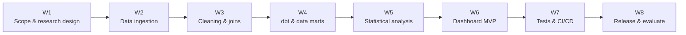
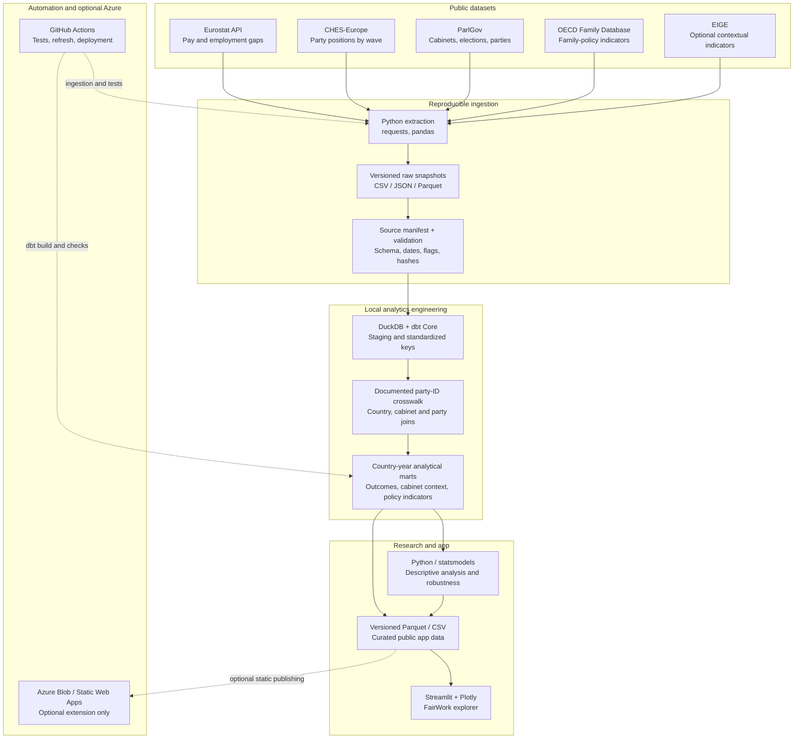
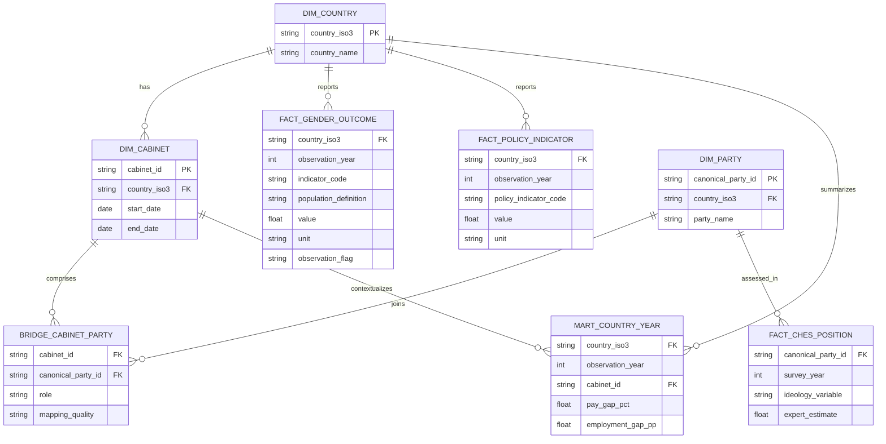
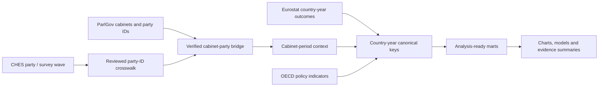
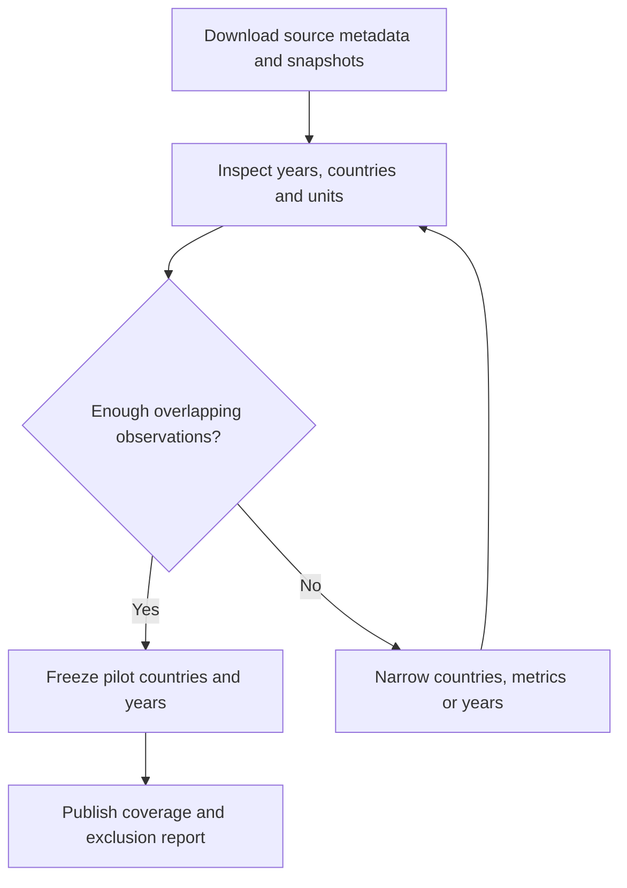
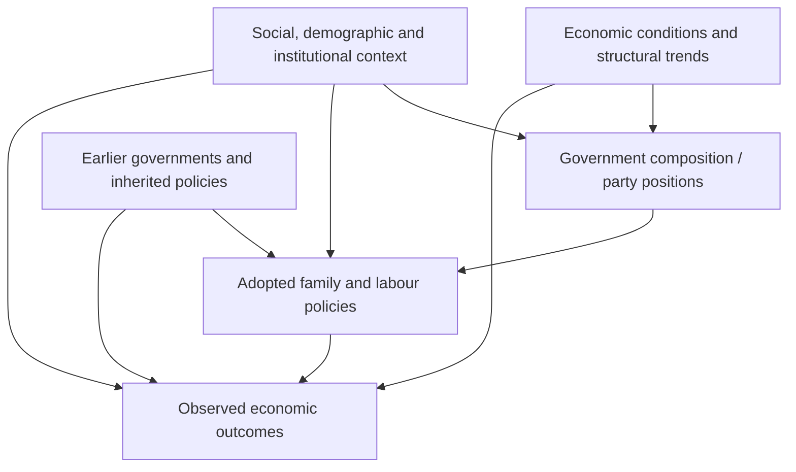
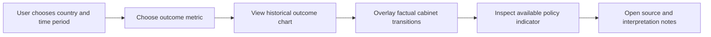
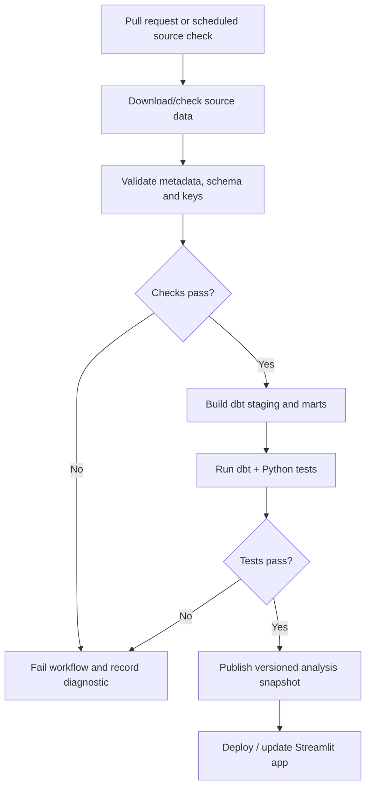

# FairWork — Project Roadmap

> **Project status:** Local foundation complete; Week 2 source-coverage audit in progress  
> **Working title:** **FairWork — Politics, Policy & Women's Economic Equality in Europe**  
> **Geographic pilot:** Germany, France, Spain and Sweden, **subject to confirmed overlap in source coverage**  
> **Proposed historical window:** **2010–2023**, subject to dataset and cabinet coverage checks  
> **Core deliverable:** A reproducible, interactive data product for exploring associations among governing coalitions, political-party positions, family/labour policies and gender-related economic outcomes.

**Planning convention:** Checked tasks are completed; unchecked tasks remain future work. Mockups, example rows and numerical targets are **illustrative or acceptance targets**, not already achieved results.

## Implementation update — 21 November 2026

Phase 2 is complete for MVP scoping. The approved countries are Germany, France, Spain and Sweden; the core outcome/political integration period is **2010–2022**, and the comparative OECD policy-context panel is **2015–2022**. EIGE is excluded from the MVP because of its 2025 methodology reset. See `reports/phase_2_scope_decision.md` for evidence, exclusions and publication conditions. Phase 3 harmonization is next.

**Phase 3 update — 21 November 2026:** Country identifiers, approved outcome facts, dated cabinet periods and the party-crosswalk review queue have been created. Nineteen party links are accepted and seven remain intentionally quarantined. See `reports/phase_3_harmonization.md`. Phase 4 analytics engineering is next.

---

## 1. Project Overview

### 1.1 Problem statement

Public debate often asks whether left-wing or right-wing governments have different effects on women's economic opportunities. Yet such comparisons can be misleading when they ignore coalition governments, delayed policy effects, macroeconomic conditions, variation in datasets, and differences between **party positions**, **adopted policies** and **observed outcomes**.

**FairWork will** build an evidence-driven platform to help users explore these distinctions. It will combine reputable European political and socioeconomic datasets, explain how indicators are measured, visualize historical trends, and report associations **without presenting correlation as causation**.

### 1.2 Primary research questions

1. **Political ideology:** How will documented party positions and governing-coalition composition relate to subsequent trends in gender pay and employment gaps?
2. **Government transitions:** What will the data show about outcome trends before and after changes in national governments?
3. **Policies:** How will childcare, parental-leave and related policy indicators relate to women's labour-market participation, where time-series coverage permits analysis?
4. **Representation:** How will women's political representation vary over time, and what relationships with economic indicators can be observed?
5. **Data transparency:** How will missing observations, breaks in methodology, uncertainty and non-comparable measures alter apparent findings?

### 1.3 Intended users

- Students and researchers learning applied public-policy and political-economy analytics.
- Journalists and civic-data enthusiasts looking for transparent, sourced historical comparisons.
- Analysts interested in cross-country panel data, data engineering, causal-inference limitations and exploratory statistics.
- People interested in women's economic opportunities who want to explore evidence without a partisan ranking.

### 1.4 What the MVP will do

- Let users select a pilot country, outcome indicator and historical period.
- Plot trends in **unadjusted gender pay gaps** and **gender employment gaps** where data will be available.
- Overlay factual cabinet/government transition markers.
- Display source-attributed, expert-assessed party positions **with the original scale and survey wave clearly identified**.
- Offer a country comparison view and a policy-indicator exploration view where coverage will allow.
- Show selected descriptive associations with context on confounders and data limitations.
- Generate reproducible charts and a short evidence summary, including citations to original data.
- Include a quality-tested ETL/ELT workflow, dbt models, automated checks and a deployed demo.

### 1.5 What the MVP will **not** do

- It will **not** endorse, recommend, score, rank or label any party or ideology as inherently "better" or "worse" for women.
- It will **not** identify an election outcome as the cause of an outcome change based only on before/after trends.
- It will **not** predict elections or advise people how to vote.
- It will **not** infer a user's political preferences or collect personal voter profiles.
- It will **not** conflate a party's position with the policy negotiated by a coalition or ultimately enacted.
- It will **not** estimate an individual's wage discrimination from country-level aggregate data.
- It will **not** merge incompatible Gender Equality Index historical and revised series as though they use one method.
- It will **not** promise an automated, up-to-date 2024–2026 cabinet history from the 2023 ParlGov release.

### 1.6 Analytical design principles

- **Measurement before interpretation:** Each metric will retain its definition, unit, source, covered population, original observation year, release date and flags.
- **Political neutrality:** Political actor names and original source-defined positions will be presented factually, without moral or electoral rankings.
- **Transparency:** All derived indicators will be documented, and uncertainty will be displayed.
- **Reproducibility:** Each result will be traceable to versioned inputs, SQL/Python transformations and a reproducible analysis notebook.
- **No invented data:** Missing values and unsupported policy-event dates will remain missing rather than being fabricated or silently extrapolated.

---

## 2. Timeline & Estimated Effort

| Phase | Week | Estimated effort | What will be delivered |
|---|---:|---:|---|
| 1. Research scope & architecture | 1 | 8–10 h | Research questions, methodology, country scope, system design |
| 2. Dataset discovery & ingestion | 2 | 12–14 h | Documented, reproducible ingestion of political and gender data |
| 3. Data cleaning & political joins | 3 | 12–14 h | Validated country-year panel and cabinet-party mappings |
| 4. Analytics engineering & optional cloud | 4 | 12–14 h | dbt models, data-quality checks, curated analysis marts |
| 5. Statistical analysis & interpretation | 5 | 16–20 h | Trends, descriptive models, robustness checks and limitations |
| 6. Interactive FairWork dashboard | 6 | 12–16 h | Working country, government and policy explorer |
| 7. Automated QA & CI/CD | 7 | 12–14 h | Tests, scheduled source checks, data provenance, deployment pipeline |
| 8. Deployment, evaluation & portfolio | 8 | 10–14 h | Public demonstration, methods report and GitHub case study |
| **Total** | **8 weeks** | **94–116 h** | **Portfolio-ready exploratory research MVP** |

**Pacing:** The default plan will use approximately 12–15 hours per week. If only 5–7 hours per week are available, a similar scope will likely take **14–20 weeks**. One or two extra weeks of contingency will be kept available for party-matching and data-coverage difficulties.

### 2.1 Visual project timeline



### 2.2 Milestones and acceptance evidence

| Target | Milestone | Evidence that will be produced |
|---|---|---|
| **End of W2** | Data acquisition | Source manifest, downloaded snapshots, ingestion logs and source schemas |
| **End of W3** | Analysis-ready historical panel | Verified country-year keys, crosswalk and data-coverage audit |
| **End of W4** | Tested analytics layer | dbt build, passing data-quality tests and documented metric definitions |
| **End of W5** | Reproducible research baseline | Notebooks with assumptions, descriptive comparisons and sensitivity checks |
| **End of W6** | Functional application | A nontechnical user can explore countries, historical cabinets and gender indicators |
| **End of W8** | Public portfolio release | Live demo, source citations, evaluation report, repo and case study |

---

## 3. Verified Public Data Sources

Sources below are relevant official or project-owned pages that were checked during planning on **13 November 2026**. Data availability, licensing, row-level country coverage and current access methods will be verified again during implementation.

| Source | Planned datasets / use | Access / caveats |
|---|---|---|
| [Eurostat — Unadjusted gender pay gap (`sdg_05_20`)](https://ec.europa.eu/eurostat/databrowser/view/sdg_05_20/default/table?lang=en) | Country-year unadjusted pay-gap outcome | Official source covers historical years through **2024** as currently published; this is not a measure of equal pay for equal work. |
| [Eurostat — Gender employment gap (`sdg_05_30`)](https://ec.europa.eu/eurostat/databrowser/view/sdg_05_30/default/table?lang=en) | Difference between female and male employment rates | Use percent **points**, not a percent change. The relevant population/age definition will be retained. |
| [Eurostat — Employment rate (`lfsi_emp_a`)](https://ec.europa.eu/eurostat/databrowser/view/lfsi_emp_a/default/table?lang=en) | Optional female/male employment rates | Dimensions and flags will be checked before extraction. |
| [CHES-Europe, 1999–2024 trend file](https://www.chesdata.eu/ches-europe/) | Expert-assessed party positions, party IDs, survey waves | Survey waves are **not annual**. The MVP will not assume measured changes occurred every intervening year. |
| [ParlGov data information](https://www.parlgov.org/data-info/) | Cabinets, parties and elections | Public development release is dated **4 November 2023**; it cannot, by itself, validate recent cabinets. |
| [OECD Family Database](https://www.oecd.org/en/data/datasets/oecd-family-database.html) | Parental leave, childcare and family-policy indicators | Individual measures will be admitted only after checking country-year consistency and methods. |
| [EIGE Gender Equality Index](https://eige.europa.eu/gender-equality-index) | Optional equality dimensions and gender representation context | Its **2025 methodology reset is not directly comparable** with preceding index values; it will be handled as a separate series or post-MVP module. |
| [EIGE Index methodology report](https://eige.europa.eu/publications-resources/publications/gender-equality-index-methodological-report) | Rules for interpreting EIGE data | Will be used to document structural breaks and avoid invalid long-run index comparisons. |

### 3.1 Data availability and selection gate

During W2, the project **will** establish a matrix covering `country × year × dataset × metric` for 2010–2023. The pilot countries and final timeframe **will be reduced if required** so analyses use only the overlapping, sufficiently documented observations.

The application **will not** assume all CHES parties match every ParlGov cabinet or that every OECD policy measure is annual. Party-name ambiguities and missing years **will** be surfaced in the data report.

### 3.2 Important source interpretation notes

- Eurostat's unadjusted pay-gap indicator will be labelled as **the difference between average gross hourly earnings of male and female paid employees, expressed as a percentage of male earnings**, within the dataset's coverage. It does not prove discriminatory treatment in an otherwise identical job.
- The gender employment gap will be expressed in **percentage points**, with its age-group definition exposed in the metadata.
- CHES will supply **expert survey estimates of party positions**, not value judgments made by FairWork.
- ParlGov will supply cabinet membership and election history; it will not be treated as complete beyond the release's historical coverage.
- OECD family measures will be labelled as policy/context variables, not automatically as exogenous interventions.
- EIGE revised index scores will not be concatenated with earlier scores without an official, comparable historical bridge.

---

## 4. Planned Technical Architecture

**Design choice:** A low-cost Python + DuckDB + dbt pipeline will prepare a small, versioned research dataset. A Streamlit application will read the curated output. This will avoid running a paid database or always-on backend for every visit.



### 4.1 Proposed stack

| Layer | Planned tools | Why they will be used |
|---|---|---|
| Ingestion | Python, `requests`, pandas, official downloads | Reproducible source retrieval |
| Raw snapshots | CSV / JSON / Parquet + Git release/artifact storage | Reproducibility, provenance and source version tracking |
| Warehouse/engine | **DuckDB** | Lightweight SQL analytical processing without idle cloud charges |
| Analytics engineering | **dbt Core** + `dbt-duckdb` | Documented transformations, quality tests and dimensional modelling |
| Statistical analysis | Python, NumPy, pandas, statsmodels, optional `linearmodels` | Trends, panel analyses and sensitivity checks |
| Visualization | **Streamlit** + Plotly | Fast, interactive public application |
| Automation | GitHub Actions | Ingestion checks, linting, tests and deployment workflow |
| Optional cloud | Azure Blob Storage or Azure Static Web Apps | Additional Azure skills if useful and within budget |
| Documentation | Markdown, Mermaid, dbt docs, Jupyter notebooks | Transparent technical and research communication |

### 4.2 Why Azure is optional in the MVP

The first application **will run on Streamlit Community Cloud or an equivalent free platform**. Azure Static Web Apps will be used **only** if a separate static frontend is introduced; it will **not** be represented as a host for a full Python Streamlit runtime. A small Azure Blob Storage integration may be added later to demonstrate cloud object storage, but will not be required to complete FairWork.

---

## 5. Target Data Model

The project will use explicit grains and stable keys. No join will silently multiply records when one party belongs to several cabinets or one measure has several demographic dimensions.

### 5.1 Logical entity relationship diagram



**Important:** This diagram will be a planning model, not a claim that every field is present in every dataset. Key definitions will be finalized after source inspection. Cabinet transitions within a calendar year may require **multiple cabinet-period records** or a separately documented annual exposure convention rather than exactly one cabinet ID per country-year. The final mart will preserve that ambiguity explicitly.

### 5.2 Target analytics grains

| Model | Intended grain |
|---|---|
| `stg_eurostat_pay_gap` | Country × year × indicator configuration |
| `stg_eurostat_employment_gap` | Country × year × relevant age/sex dimensions |
| `stg_ches_party_positions` | Country × party × survey wave × ideology dimension |
| `stg_parlgov_cabinets` | One historical cabinet period |
| `bridge_cabinet_party` | Cabinet × participating party |
| `fact_gender_outcome` | Country × year × metric × population definition |
| `fact_policy_indicator` | Country × year × policy metric |
| `mart_country_year` | Country × year × outcome, plus clearly defined cabinet context |
| `mart_country_transition` | Country × government transition event × observation window |

### 5.3 Join strategy and data lineage



**Mapping rules that will be enforced:**

- Country codes will be standardized to one ISO convention with explicitly checked exceptions.
- Party linkage will use source identifiers when possible; manually reviewed mappings will be stored in version control with provenance.
- Ambiguous party matches will be quarantined for review rather than auto-accepted via fuzzy matching.
- Party positions will retain the **original CHES survey year**. Interpolation will be an optional sensitivity analysis, never disguised as observed annual data.
- Coalition members will not be assigned invented policy positions. If an exploratory coalition aggregate is calculated, its weighting method and uncertainty will be explicit and it will **not** be treated as a moral score or political recommendation.
- The same-year and lagged outcomes will be kept distinct, and incomplete data will remain missing.

---

## 6. Phase-by-Phase Implementation Plan

### Phase 1 — Research Design & System Architecture

**Timing:** Week 1 · **8–10 hours**  
**Objective:** The research question, measurable variables, boundaries and minimum viable scope **will be finalized**.

#### Work that will be done

- [ ] Create the GitHub repository and a project board with week-level milestones.
- [x] Write a clear problem statement about women's economic outcomes and documented political/policy context.
- [x] Define the primary outcome variables: unadjusted gender pay gap and gender employment gap.
- [x] Select four tentative pilot countries, subject to source overlap and adequate observations.
- [x] Define the 2010–2023 proposed observation window and required source granularity.
- [x] Predefine at least three exploratory analyses and the minimum statistical controls to be considered.
- [x] Create a measurement glossary and a political-neutrality note.
- [x] Draw the system architecture, data lineage and planned dashboard wireframe.
- [x] Document what the project will **not** infer from aggregate data.

#### Deliverables

- `docs/requirements.md`
- `docs/research_questions.md`
- `docs/methodology_plan.md`
- `docs/architecture.md`
- `docs/metric_dictionary.md`

#### Exit criterion

A reader **will** be able to understand the research questions, intended user experience, units and limits without looking at source code.

---

### Phase 2 — Dataset Discovery & Ingestion

**Timing:** Week 2 · **12–14 hours**  
**Objective:** Relevant public datasets **will be acquired repeatably and documented**.

#### Work that will be done

1. [ ] Download Eurostat country-level pay-gap and gender employment-gap series, including observation flags and metadata.
2. [ ] Obtain the CHES-Europe trend file plus the relevant codebook.
3. [ ] Download ParlGov party, election and cabinet data plus codebook.
4. [ ] Inspect OECD Family Database measures and select only one or two usable policy-related series.
5. [ ] Record EIGE methodology and identify any optional indicators that can be used without crossing an invalid comparability boundary.
6. [ ] Write reusable Python extraction/download scripts, including HTTP error handling and retries when relevant.
7. [ ] Preserve source snapshot hashes, retrieval timestamps, licensing and original dataset identifiers.
8. [ ] Produce a source-overlap report across countries and years.
9. [ ] Decide whether the pilot countries or historical period will need to be narrowed.

#### Source availability diagram



#### Deliverables

- `src/ingestion/` scripts
- `data/raw/` snapshots or documented external artifact references
- `data/metadata/source_manifest.yml`
- `reports/source_coverage.md`
- `docs/source_attribution.md`

#### Exit criterion

A fresh, documented run **will** reproduce the source acquisition and clearly identify any missing or excluded source observations.

---

### Phase 3 — Cleaning, Harmonization & Political Data Joins

**Timing:** Week 3 · **12–14 hours**  
**Objective:** Raw inputs **will be transformed into reliable analytical tables**.

#### Work that will be done

1. [ ] Normalize country labels/codes, dates, units, numeric formats and missing-value markers.
2. [ ] Parse Eurostat observation flags and preserve dataset coverage definitions.
3. [ ] Create canonical party identifiers and a reviewed CHES↔ParlGov crosswalk.
4. [ ] Convert cabinet starting and ending dates into documented calendar-year exposures.
5. [ ] Handle countries with more than one cabinet in the same year without arbitrary overwriting.
6. [ ] Explicitly distinguish CHES survey-year positions from non-survey years.
7. [ ] Standardize selected OECD policy measures while preserving their unit and measurement method.
8. [ ] Build a country-year observation-coverage report and detect duplicate join keys.
9. [ ] Create a reproducible, small sample panel for local analysis.

#### Data-quality priorities

- Primary keys **will** be unique at their defined grains.
- Date intervals **will** be checked for overlapping or missing cabinet records.
- A join **will not** increase row counts unexpectedly.
- Values **will** be screened for implausible units or scales.
- Unmatched parties and empty statistical years **will** be recorded in an exception report.
- No gap-filling procedure **will** occur without a separate modelled/estimated flag.

#### Deliverables

- Country and party crosswalk tables
- Validated cabinet-party relationships
- Standardized gender-outcome tables
- Country-year coverage summary
- `reports/join_audit.md`

#### Exit criterion

A documented SQL query **will** produce a country-year analysis panel without hidden many-to-many duplication and with traceable source fields.

---

### Phase 4 — dbt Analytics Engineering & Optional Cloud Storage

**Timing:** Week 4 · **12–14 hours**  
**Objective:** Transformations **will become tested, reusable analytical assets**.

#### Work that will be done

1. [ ] Configure DuckDB and dbt Core with the `dbt-duckdb` adapter.
2. [ ] Build staging models for Eurostat, CHES, ParlGov and selected policy inputs.
3. [ ] Create intermediate models for keys, cabinet events and political source metadata.
4. [ ] Define `fact_gender_outcome`, `fact_policy_indicator` and exploration marts.
5. [ ] Add dbt `not_null`, `unique`, `relationships` and accepted-value tests where appropriate.
6. [ ] Add custom SQL tests for country-year uniqueness and expected metric units.
7. [ ] Document measures, source lineage, analytical grains and limitations.
8. [ ] Produce a curated Parquet output for downstream analysis and the Streamlit app.
9. [ ] If time remains, add an optional Azure Blob Storage export with strict budget limits.

#### Example target tests

| Model / field | Test that will be implemented |
|---|---|
| `dim_country.country_iso3` | Unique, non-null |
| `dim_party.canonical_party_id` | Unique, non-null |
| `bridge_cabinet_party` | Unique combined cabinet/party key |
| `fact_gender_outcome` | Unique country/year/metric/population key |
| `fact_gender_outcome.unit` | Accepted unit defined by the metric dictionary |
| `fact_gender_outcome.value` | Plausible, source-consistent range; not an arbitrary absolute cutoff |
| `fact_ches_position` | Survey wave belongs to documented CHES waves (implementation name to be finalized) |
| `mart_country_year` | No unexpected row multiplication |

#### Deliverables

- `dbt_project.yml`
- Staging, intermediate and mart models
- dbt schema and custom SQL tests
- Generated dbt documentation
- Curated local data files

#### Exit criterion

The same checked-in data snapshot and dbt command **will** rebuild reproducible, documented and tested tables.

---

### Phase 5 — Statistical Analysis & Responsible Interpretation

**Timing:** Week 5 · **16–20 hours**  
**Objective:** A credible analytical baseline **will be developed without overclaiming causality**.

#### Planned analyses

**A. Descriptive trends**

- [ ] Plot country-level pay and employment gaps over the observed years.
- [ ] Overlay factual cabinet changes and mark CHES survey waves distinctly.
- [ ] Compare policy indicators, identifying missing years and inconsistent definitions.

**B. Associations and covariates**

- [ ] Inspect basic correlations, distributions, outliers and sample size.
- [ ] Define appropriate country-level controls if reliable overlapping data are available (for example, GDP growth and unemployment rate).
- [ ] Estimate a descriptive panel model with country and year fixed effects **only if the sample and assumptions support it**.
- [ ] Add lagged explanatory variables where justified; explain that this does not automatically solve confounding.

**C. Government transition explorations**

- [ ] Plot windows surrounding selected cabinet changes.
- [ ] Distinguish an outcome's immediate observation year from a plausible period for policy effects to emerge.
- [ ] Label all before/after figures as **descriptive**, not causal policy impacts.

**D. Robustness and uncertainty**

- [ ] Compare results using alternative observation windows.
- [ ] Rerun models after excluding incomplete/methodologically inconsistent years.
- [ ] Examine changes caused by political-party mappings and survey-wave treatment.
- [ ] Report confidence intervals or standard errors where appropriate, along with assumptions and effective sample sizes.
- [ ] Publish results that do **not** show an association as clearly as results that do.

#### Conceptual confounding diagram



**Interpretation rule:** The arrows in this diagram are **hypothesized relationships to consider**, not causal effects established by FairWork. Government ideology, policy choices and outcomes are not interchangeable variables.

#### Planned statistical outputs

- `notebooks/01_exploration.ipynb`
- `notebooks/02_descriptive_panel.ipynb`
- `reports/statistical_results.md`
- `reports/assumptions_and_limitations.md`
- Reproducible chart exports and model specification notes

#### Exit criterion

At least three meaningful descriptive analyses **will** be reproducible and accompanied by limitations, source references, sample sizes and appropriate caveats.

---

### Phase 6 — FairWork Interactive Dashboard

**Timing:** Week 6 · **12–16 hours**  
**Objective:** Technical work **will be accessible to nontechnical users** through a clear, interactive interface.

#### Planned pages

| Page | Features that will be built |
|---|---|
| **Overview** | Project explanation, outcomes, definitions, sample coverage |
| **Country Explorer** | Country selector, year range, employment/pay-gap charts |
| **Political Timeline** | Cabinet transitions with source citations and separately labelled CHES party measurements |
| **Compare Countries** | Side-by-side descriptive trends, compatible units and data-availability indicators |
| **Policy Explorer** | Selected OECD measures, cautious time-series comparisons and documented limitations |
| **Methods & Sources** | Dataset definitions, caveats, original links, last refresh, exclusions |

#### Interaction flow



#### Text-based dashboard wireframe

```text
+---------------------------------------------------------------+
| FairWork | Politics, Policy & Women's Economic Equality       |
| [Country] [Year range] [Outcome measure] [Source definitions] |
+---------------------------------------------------------------+
| Outcome trend over time                                       |
|   line plot: gender pay gap OR employment gap                 |
|   dotted markers: cabinet transitions                         |
|   data flags: missing year / incomparable series              |
+--------------------------------+------------------------------+
| Governing cabinet context      | Selected policy indicator    |
| Date, coalition parties        | Childcare / leave metric     |
| Original source links          | Units and source notes       |
+--------------------------------+------------------------------+
| Interpretation notes and limitations                         |
| Descriptive trends are not evidence of causal effects.        |
+---------------------------------------------------------------+
```

#### Work that will be done

- [ ] Implement accessible filters and consistent chart labels.
- [ ] Build country-year timeline visualizations in Plotly.
- [ ] Display cabinet transitions based on verified source dates.
- [ ] Show the sample size and data gaps for selected analyses.
- [ ] Add a visible methodology and political-neutrality explanation.
- [ ] Provide CSV download of publicly shareable analytical summaries when source licences permit.
- [ ] Add caching and avoid re-running every transformation during UI interaction.
- [ ] Handle empty filters, unavailable comparisons and optional missing OECD series.

#### Exit criterion

A user unfamiliar with the source datasets **will** be able to ask a question about a country's trends, inspect the evidence and understand the project's analytical boundaries.

---

### Phase 7 — Testing, Automation & CI/CD

**Timing:** Week 7 · **12–14 hours**  
**Objective:** FairWork **will behave like a maintainable data product rather than a one-off notebook**.

#### Work that will be done

- [ ] Add Python tests for parsing, country-code mapping and party-ID mapping.
- [ ] Run dbt tests and detect duplicate or missing analytical keys.
- [ ] Add model tests with small synthetic fixtures for cabinet transition edge cases.
- [ ] Configure GitHub Actions to run formatting, tests and a representative data build on pull requests.
- [ ] Introduce a scheduled upstream source-check workflow, without assuming published data change daily.
- [ ] Compare new vs previous source snapshots, reporting revisions and missing years.
- [ ] Publish a data freshness/date-of-retrieval label in the app.
- [ ] Configure a failure summary or GitHub issue when data validation fails.
- [ ] Verify an environment-reproducible install and deployment.

#### Automation design



#### Exit criterion

Data transformations and app changes **will** be checked automatically before being released, and upstream data revisions **will** be detectable.

---

### Phase 8 — Deployment, Evaluation & Portfolio Release

**Timing:** Week 8 · **10–14 hours**  
**Objective:** The project **will be published with enough documentation and evaluation to stand up to technical interview questions**.

#### Work that will be done

1. [ ] Deploy the Streamlit demo using free hosting if quota and availability permit.
2. [ ] Validate the application on desktop and mobile-width screens.
3. [ ] Test a set of predefined country/year/metric combinations.
4. [ ] Manually reconcile selected displayed values to the original published source tables.
5. [ ] Audit cabinet labels, coalition mapping and observed-versus-modelled-year distinctions.
6. [ ] Produce a research summary with balanced interpretation and methodological limitations.
7. [ ] Add a README with architecture, entity-relationship and CI/CD diagrams.
8. [ ] Publish screenshots, a short feature demonstration and project setup instructions.
9. [ ] Publish an evaluation table summarizing test coverage, data completeness and build reliability.
10. [ ] Draft accurate portfolio and CV bullets **only after implementation and measurement**.

#### Evaluation target examples

| Dimension | What will be measured |
|---|---|
| Ingestion reliability | Succeeded/failed source refreshes across test runs |
| Data coverage | Available observations by country, metric and year |
| Source mapping | Reviewed, ambiguous and unmatched political-party links |
| Data quality | Passing dbt/Python tests and number of data anomalies |
| Statistical validity | Sample sizes, uncertainty, robustness variations |
| UI correctness | Successful interactions and comparison results across test scenarios |
| Performance | Cached dashboard load and filter-response time |
| Documentation | Source definitions, reproducibility instructions, risks and caveats |

#### Exit criterion

A recruiter or reviewer **will** be able to open the demo, inspect the source-backed historical evidence, and reproduce the main analysis from the repository documentation.

---

## 7. Research Methodology: What FairWork Will and Will Not Conclude

### 7.1 Descriptive analysis vs causal inference

FairWork's central political comparison **will be observational**. An outcome improving during a government's term will not, by itself, prove that the government's ideology or policies caused the improvement. A negative or positive association will be reported as such, together with economic and methodological caveats.

A formal policy evaluation, if added after the MVP, **will require a separately justified identification strategy**, a defined treatment, a defensible comparison group, pre-trend diagnostics and country-specific policy implementation dates from primary documents.

### 7.2 Party ideology is not the same as government action

- CHES positions will be treated as expert survey measures for **specific parties and waves**.
- ParlGov cabinets will be used to establish **who governed and when**, not to infer an enacted policy automatically.
- Coalition members may differ and negotiate policies; their presence will not be reduced to simplistic political labels.
- Any exploratory government-composition variable will be defined transparently and used for analysis, **not** for endorsement or comparative political ratings.

### 7.3 Policy data are not automatically comparable

- Statutory leave length, payment generosity and eligibility can differ, so policy variables will carry documented definitions.
- Reported calendar-year values may lag policy enactment.
- Structural breaks in EIGE methodology will be identified explicitly.
- Annual socioeconomic indicators can reflect circumstances that predate a cabinet's term.
- Country fixed effects and year fixed effects will not eliminate all confounding or measurement error.

### 7.4 Interpretation example

**Acceptable style (illustrative):** “In the observed sample, the employment gap changed during this cabinet period. The timing is descriptive and cannot establish whether government decisions caused the change.”

**Unacceptable claim for the MVP:** “This political ideology caused the gap to improve, therefore it is the best option.”

### 7.5 Ethical and privacy safeguards

- Only public, aggregated political and socioeconomic datasets will be used in the MVP.
- The app will not collect users' voting choices, personal political beliefs or individual salaries.
- Charts will include clear timeframes and population definitions.
- The project will avoid partisan rankings, electoral persuasion and causal overclaims.
- Transparent source citations and a corrections process will be included.

---

## 8. Proposed Repository Structure

```text
fairwork/
├── README.md
├── ROADMAP.md
├── LICENSE
├── pyproject.toml                 # or requirements.txt
├── .env.example
├── .gitignore
├── .github/
│   └── workflows/
│       ├── ci.yml
│       └── source_refresh_check.yml
├── docs/
│   ├── requirements.md
│   ├── research_questions.md
│   ├── methodology_plan.md
│   ├── architecture.md
│   ├── metric_dictionary.md
│   ├── source_attribution.md
│   └── limitations.md
├── data/
│   ├── metadata/
│   │   ├── source_manifest.yml
│   │   └── party_crosswalk.csv
│   ├── raw/                      # follow source licences and Git size rules
│   ├── processed/
│   └── published/
├── src/
│   ├── ingestion/
│   │   ├── eurostat.py
│   │   ├── ches.py
│   │   ├── parlgov.py
│   │   └── oecd.py
│   ├── transforms/
│   │   ├── harmonize_countries.py
│   │   ├── match_parties.py
│   │   └── build_cabinet_periods.py
│   ├── analysis/
│   │   ├── descriptive.py
│   │   ├── panel_models.py
│   │   └── sensitivity.py
│   └── app/
│       ├── app.py
│       └── pages/
│           ├── country_explorer.py
│           ├── political_timeline.py
│           ├── compare_countries.py
│           └── methods_and_sources.py
├── dbt/
│   ├── dbt_project.yml
│   ├── models/
│   │   ├── staging/
│   │   ├── intermediate/
│   │   └── marts/
│   ├── tests/
│   └── macros/
├── notebooks/
│   ├── 01_exploration.ipynb
│   └── 02_descriptive_panel.ipynb
├── tests/
│   ├── test_source_parsing.py
│   ├── test_country_crosswalk.py
│   ├── test_party_crosswalk.py
│   └── test_cabinet_periods.py
├── reports/
│   ├── source_coverage.md
│   ├── join_audit.md
│   ├── statistical_results.md
│   ├── assumptions_and_limitations.md
│   └── final_evaluation.md
└── assets/
    ├── screenshots/
    └── diagrams/
```

This is a **target layout**. Files will be introduced phase-by-phase rather than all being created empty on day one.

---

## 9. Full Implementation Checklist

### Week 1 — Scope

- [x] Finalize problem, research questions and non-causal boundaries.
- [x] Choose the initial countries and target historical period.
- [x] Create architecture and dashboard sketches.
- [ ] Create source/metric definitions and GitHub project tracking.

### Week 2 — Ingestion

- [ ] Retrieve Eurostat indicators and metadata.
- [ ] Retrieve CHES and ParlGov source files.
- [ ] Inspect selected OECD policy variables and EIGE caveats.
- [ ] Build and run data download/validation scripts.
- [ ] Publish country-year overlap and source manifest.

### Week 3 — Harmonization

- [ ] Standardize countries, years and units.
- [ ] Create reviewed party and cabinet mappings.
- [ ] Handle cabinet transitions and non-survey years transparently.
- [ ] Audit duplicates and unmatched records.
- [ ] Produce a documented country-year analysis panel.

### Week 4 — Analytics engineering

- [ ] Set up DuckDB and dbt Core.
- [ ] Build staging and mart models.
- [ ] Implement dbt quality checks and lineage documentation.
- [ ] Export curated Parquet files.
- [ ] Optionally test Azure Blob export if budget allows.

### Week 5 — Analysis

- [ ] Create exploratory country trend charts.
- [ ] Explore documented government transitions.
- [ ] Analyze policy indicators and major data gaps.
- [ ] Fit only defensible descriptive statistical models.
- [ ] Publish limitations, robustness results and sample sizes.

### Week 6 — Dashboard

- [ ] Build country/year/metric filters.
- [ ] Add political timeline overlays.
- [ ] Add cross-country and policy panels.
- [ ] Implement source citations and data-quality labels.
- [ ] Test empty filters and missing data.

### Week 7 — Quality & automation

- [ ] Add Python and dbt tests.
- [ ] Configure GitHub Actions CI.
- [ ] Add source-refresh/revision monitoring.
- [ ] Test reproducible environment and deployment.
- [ ] Add automated failure reporting.

### Week 8 — Release

- [ ] Deploy the Streamlit MVP.
- [ ] Validate published metrics against originals.
- [ ] Publish the README, diagrams, evaluation and case study.
- [ ] Record a short demo and take screenshots.
- [ ] Review all political and statistical claims before release.

---

## 10. Cloud Costs & Budget Protection

The first implementation **will prioritize free, local and open-source tooling**.

| Component | MVP approach | Budget handling |
|---|---|---|
| Python, DuckDB, dbt Core, Plotly | Local development | Free/open-source |
| GitHub repository / Actions | CI, code and source checks | Use included quotas and avoid oversized artifacts |
| Streamlit Community Cloud | Public Python demo | Free hosting option, subject to current limits |
| Raw dataset storage | Small local Parquet/CSV snapshots | Keep only licensable, necessary data in Git; use releases or documented downloads for large artifacts |
| Azure Blob Storage | Optional later export | Not required for MVP; monitor usage and transactions |
| Azure Static Web Apps | Optional independent frontend | Free tier available, but not a direct Streamlit host |
| Paid APIs, managed database, LLM calls | Not planned | Will be avoided in MVP |

### Budget controls that will be implemented

- [ ] Set a target recurring project spend of **€0** and an optional ceiling of **€5/month** before activating paid services.
- [ ] Use local data builds and cached static snapshots where possible.
- [ ] Avoid always-on Azure VMs, managed databases and paid model inference.
- [ ] Review free plan limits and configure cost alerts if paid Azure resources are introduced.
- [ ] Verify that source downloads and app hosting comply with applicable usage/licence terms.
- [ ] Disable or remove unused cloud resources after testing.

**Cost warning:** The €0–€5 range is a planning target, **not a promise**. Cloud vendors can change quotas and some linked services may require a subscription, credit card or extra charges.

---

## 11. Risks, Dependencies & Mitigation

| Risk | Why it matters | What will be done |
|---|---|---|
| Different year/country coverage | Reduces valid comparisons | Build coverage matrix early; narrow pilot instead of manufacturing observations |
| CHES is wave-based rather than annual | Risk of invented yearly ideology values | Preserve survey waves and avoid unsupported interpolation |
| Historical party identity differences | Incorrect cabinet-party join | Use reviewed mappings, ID provenance and unmatched-record reports |
| Multiple cabinets within a year | Ambiguous annual political context | Retain cabinet periods or transparent annual exposure rules |
| EIGE 2025 methodology change | Inconsistent longitudinal index | Keep incompatible index generations separate |
| Aggregate pay-gap interpretation | Could be confused with direct discrimination | Display precise definitions and limitations |
| Confounding and reverse causality | Partisan narratives may overstate impact | Use descriptive language, controls where appropriate and robustness checks |
| Policy enactment-date uncertainty | Invalid event-study conclusions | Defer causal claims without dated primary legal sources |
| Data licensing or rate limits | Sharing/automation may be restricted | Read source terms, provide attribution and use appropriate caching |
| Deployment resource limits | Large data loads can slow Streamlit | Precompute marts, cache outputs and restrict pilot size |
| Political bias in presentation | Could mislead or alienate users | Show sourced facts, consistent chart units and no party endorsement or ranking |

---

## 12. Out-of-Scope Features / Post-MVP Ideas

The following improvements **may be considered only after the MVP is validated**:

1. A carefully designed **policy implementation timeline** backed by official enactment and effective dates.
2. A formal quasi-experimental design for a narrowly defined reform, if a defensible comparison group and data are available.
3. Women's political representation and leadership indicators from suitable official sources.
4. Sector-specific pay-gap exploration using appropriately comparable Eurostat NACE statistics.
5. Parental-leave eligibility and childcare affordability details beyond a small OECD indicator set.
6. A separate static Azure-hosted frontend with precomputed datasets and a documented cloud release pipeline.
7. Multilingual interface (English/German), with the same statistical definitions in both languages.
8. Extended country coverage after country-to-country comparability checks.
9. Optional educational explanations of statistical concepts such as fixed effects and confounding.
10. Reproductive healthcare or gender-based violence policy coverage **only with separate, suitable, well-documented sources and ethical framing**.

---

## 13. Documentation & Source Links

### Political datasets and codebooks

- **CHES-Europe data and codebooks:** https://www.chesdata.eu/ches-europe/
- **ParlGov datasets and download formats:** https://www.parlgov.org/data-info/
- **ParlGov downloadable data directory:** https://parlgov.org/data/parlgov-development_csv-utf-8/

### Gender outcome data

- **Eurostat, unadjusted gender pay gap (`sdg_05_20`):** https://ec.europa.eu/eurostat/databrowser/view/sdg_05_20/default/table?lang=en
- **Eurostat, gender employment gap (`sdg_05_30`):** https://ec.europa.eu/eurostat/databrowser/view/sdg_05_30/default/table?lang=en
- **Eurostat, employment (`lfsi_emp_a`):** https://ec.europa.eu/eurostat/databrowser/view/lfsi_emp_a/default/table?lang=en
- **Eurostat API guide:** https://ec.europa.eu/eurostat/web/user-guides/data-browser/api-data-access/api-getting-started/api
- **OECD Family Database:** https://www.oecd.org/en/data/datasets/oecd-family-database.html
- **EIGE Gender Equality Index:** https://eige.europa.eu/gender-equality-index
- **EIGE methodology report:** https://eige.europa.eu/publications-resources/publications/gender-equality-index-methodological-report

### Engineering and deployment documentation

- **DuckDB:** https://duckdb.org/docs/stable/
- **dbt Core:** https://docs.getdbt.com/docs/core/installation-overview
- **dbt-duckdb:** https://github.com/duckdb/dbt-duckdb
- **pandas:** https://pandas.pydata.org/docs/
- **statsmodels:** https://www.statsmodels.org/stable/index.html
- **Plotly Python:** https://plotly.com/python/
- **Streamlit:** https://docs.streamlit.io/
- **Streamlit Community Cloud:** https://docs.streamlit.io/deploy/streamlit-community-cloud
- **GitHub Actions:** https://docs.github.com/en/actions
- **Azure Static Web Apps quotas:** https://learn.microsoft.com/en-us/azure/static-web-apps/quotas
- **Azure Blob Storage documentation:** https://learn.microsoft.com/en-us/azure/storage/blobs/
- **GitHub Mermaid documentation:** https://docs.github.com/en/get-started/writing-on-github/working-with-advanced-formatting/creating-diagrams

### Attribution and citation tasks

- [ ] Add a data-source bibliography with publication years, titles, download URLs and retrieval dates.
- [ ] Include the CHES team's preferred citation from the downloaded trend-file page.
- [ ] Include ParlGov's recommended citation and its **4 November 2023** release qualification.
- [ ] Attribute Eurostat indicators and preserve downloaded measurement flags.
- [ ] Record the OECD and EIGE document versions and licensing requirements.
- [ ] Add an open issue or data-correction process for disputed mappings or methods.

---

## 14. Planned Portfolio and CV Wording — **Use Only After Building**

**Working project title:** FairWork — Political Economy of Gender Equality in Europe  
**Planned stack:** Python, SQL, DuckDB, dbt Core, Plotly, Streamlit, GitHub Actions, optional Azure

**Candidate portfolio summary (future wording):**

> FairWork will be an open-data research application exploring how recorded government transitions, party positions and selected family-policy indicators relate to gender pay and employment trends across European countries. It will include versioned ingestion, tested analytical models, reproducible statistical analysis and transparent reporting of limitations.

**Candidate CV bullet, only after confirmed implementation:**

> Built a reproducible European political-economy analytics platform integrating Eurostat, CHES and ParlGov datasets; developed tested dbt models, documented cabinet-party joins and an interactive dashboard for exploring gender pay/employment trends alongside historical government changes.

**Additional measurable results that will be recorded:** Number of countries/years actually covered, source observations retained, data-quality tests passed, manually reviewed political-party mappings, data-refresh reliability and dashboard performance. **None of these will be invented in advance.**

---

## 15. Final Release Gate

FairWork **will be considered portfolio-ready only if** every item below is satisfied:

- [ ] The deployed dashboard will load and permit country/metric selection.
- [ ] All charted values will be reproducible from the documented, public source data.
- [ ] Country-year grains and cabinet-party joins will be tested and explained.
- [ ] CHES party positions will be labelled by survey year and original scale.
- [ ] Government transitions will be based on verified dates and source limitations.
- [ ] The project will clearly distinguish descriptive associations from causal claims.
- [ ] EIGE methodological breaks and other incompatible series will not be merged improperly.
- [ ] Data provenance and licences will be documented.
- [ ] CI tests will run and failures will be surfaced.
- [ ] The public README will include diagrams, setup commands, results and limitations.
- [ ] A reviewer will be able to understand both the social question and the technical contribution.

---

**Next action:** Complete the remaining Week 2 source and codebook review, then publish the cross-source coverage decision **before** interpreting any political comparison. Week 1 planning documents and a local tracking board are in `docs/`; pilot scope remains subject to the audit.
