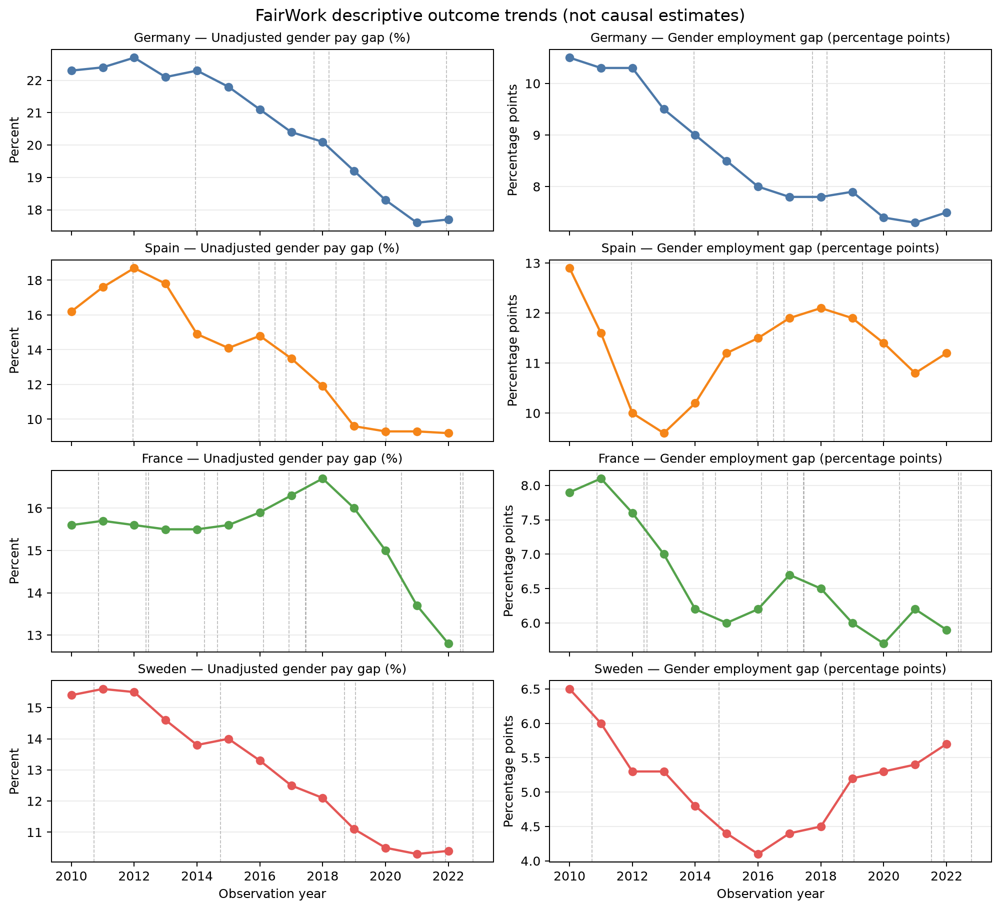
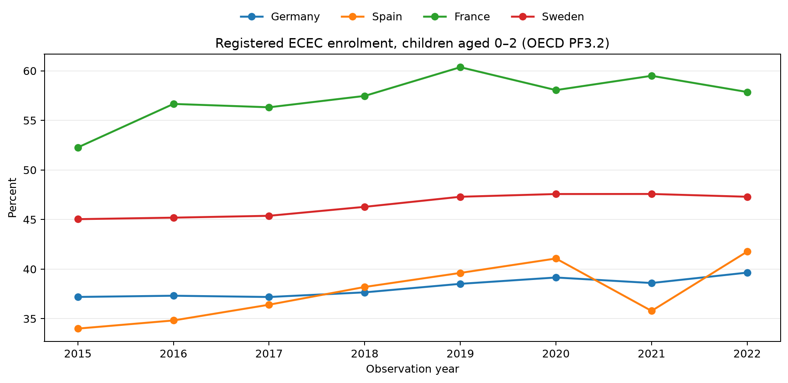
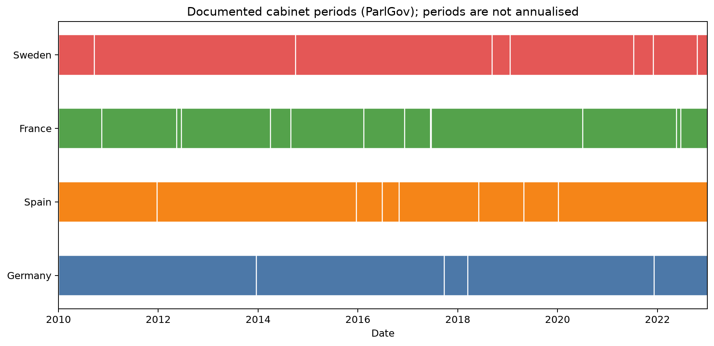
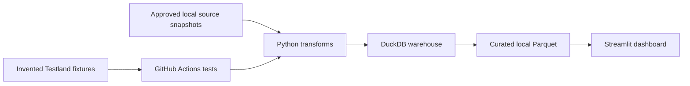
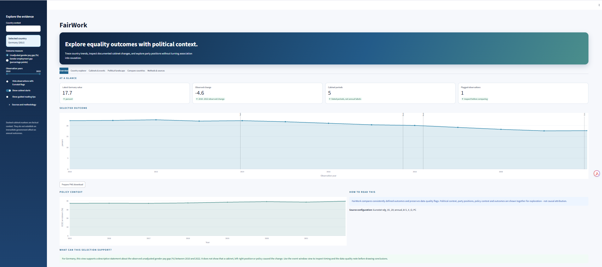
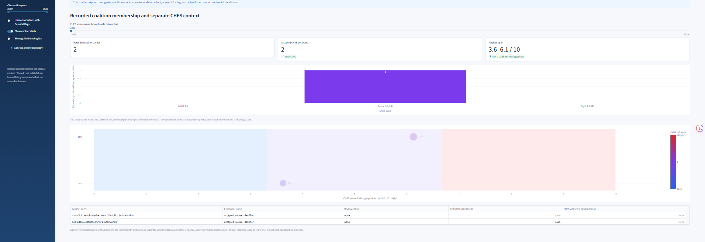
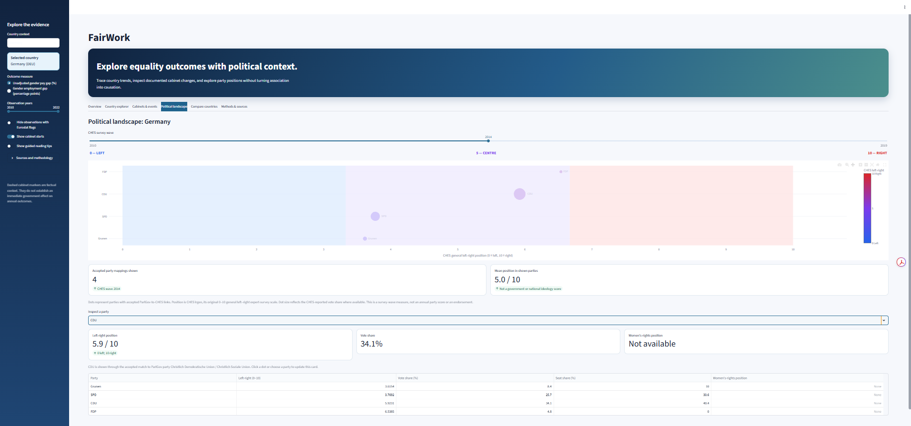
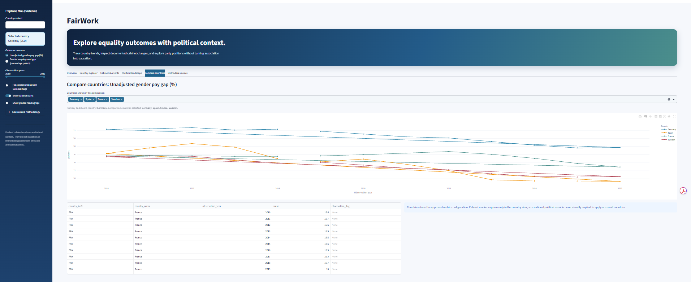
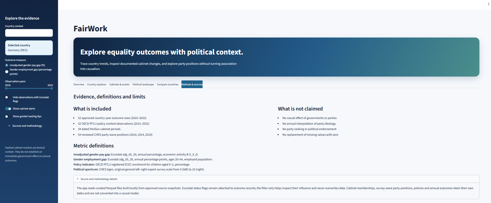
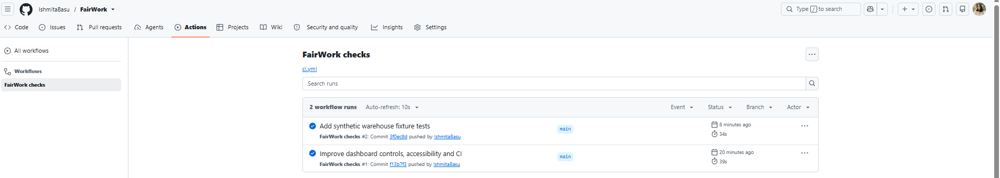

# FairWork

FairWork is a reproducible exploratory data project about governing coalitions, selected policy context and women's economic outcomes in Europe. It presents documented associations without treating them as causal effects or ranking parties or ideologies.

## Current status

**Phase 6 local dashboard is complete; Phase 7 quality automation is in progress.** The approved pilot is Germany, France, Spain and Sweden. Core outcomes and political context cover 2010–2022; the comparative OECD policy-context panel covers 2015–2022. No causal statistical analysis or public dashboard has been published.

Phase 3 produced a 52-row country-year outcome panel, 34 dated cabinet periods, and a reviewed party crosswalk with 19 accepted links. Seven unsupported party links remain quarantined. Phase 4 adds 32 OECD policy facts, 54 reviewed CHES party-wave positions, a validated local DuckDB warehouse and curated Parquet exports. Phase 5 adds reproducible descriptive figures, coverage summaries and flag-sensitivity checks. Phase 6 adds a tested local Streamlit dashboard with an interactive political spectrum.

## Planned MVP

- Explore unadjusted gender pay gaps and gender employment gaps from Eurostat.
- Show documented cabinet periods from ParlGov alongside outcome observations.
- Present CHES party positions only with their original survey wave and scale.
- Add a policy panel only where definitions and country-year coverage support a fair comparison.
- Provide source citations, data-quality context and reproducible transformation steps.

## What the analysis finds

Across the approved 2010-2022 pilot, both the unadjusted gender pay gap and the gender employment gap were lower at the final observation than the first observation in Germany, Spain, France and Sweden. The result is descriptive only: FairWork does **not** conclude that a cabinet, party position or policy caused those changes. Read the full evidence, country-level endpoints, flag-sensitivity check and limitations in the [detailed case study](docs/portfolio_case_study.md).

## Evidence visuals

### Annual outcome trends and cabinet timing



The yearly dots are Eurostat observations. Dashed lines are documented cabinet starts, not estimated treatment effects.

### ECEC policy context



The OECD series is policy context only. It is not a complete measure of family policy and is not used to attribute changes in outcomes to a government.

### Cabinet periods



Cabinet periods remain dated intervals rather than being converted into one political label for an entire year.

## Principles

- Missing observations stay missing.
- Party positions, governing participation, enacted policy and observed outcomes are distinct concepts.
- Trends and models are descriptive unless a separately justified causal design is added later.
- Every displayed value must retain source, version, definition, unit and applicable flags.

## Project map

- [Roadmap](Project%20Roadmap.md) — phases, delivery criteria, risks and planned stack.
- [Requirements](docs/requirements.md) — MVP user and release requirements.
- [Architecture](docs/architecture.md) — local Python, DuckDB, dbt and Streamlit design.
- [Methodology](docs/methodology_plan.md) — source and inference safeguards.
- [Project tracking](docs/project_tracking.md) — current status and next actions.
- [Phase 2 scope decision](reports/phase_2_scope_decision.md) — approved data scope and exclusions.
- [Phase 3 harmonization report](reports/phase_3_harmonization.md) — panel, cabinet-period and party-crosswalk results.
- [Phase 4 analytics-engineering report](reports/phase_4_analytics_engineering.md) — warehouse grain, validation and exports.
- [Phase 5 descriptive results](reports/phase_5_descriptive_results.md) — trends, cabinet context, sensitivity checks and limits.
- [Dashboard guide](docs/dashboard_guide.md) — local run instructions, filters and interpretation safeguards.
- [Phase 6 dashboard report](reports/phase_6_dashboard.md) — features, validation and publication boundary.
- [Deployment-readiness checklist](docs/deployment_readiness.md) — release gate for data terms, reproducibility and public hosting.
- [Synthetic warehouse fixture](tests/fixtures/warehouse/README.md) — invented Testland records used for CI only.
- [Portfolio case study](docs/portfolio_case_study.md) — problem, solution, technical decisions and safeguards.
- [Release evaluation](docs/release_evaluation.md) — current evidence and outstanding release gates.
- [Screenshot guide](docs/images/README.md) — portfolio screenshot descriptions and publication boundary.

## Next step

Phase 7 is in progress: GitHub Actions now runs syntax, unit tests and an invented fixture-based DuckDB warehouse build on pull requests and `main`; the next safe work is a permitted source-monitoring design.

## Architecture and quality flow



The dashboard is local-only until the data-terms and hosted-data checks in the deployment-readiness checklist are complete.

## Intended local setup

The implementation environment is declared in `pyproject.toml`; the `audit` extra includes `openpyxl` and the `pipeline` extra includes DuckDB. Raw source snapshots and credentials remain outside version control.

Install the full local project environment from the repository root:

```powershell
python -m pip install -e ".[audit,pipeline,analysis,dashboard]"
```

## Rebuild the local analytics assets

After obtaining the approved local source snapshots and metadata, run:

```powershell
python -m src.transforms.build_outcome_panel
python -m src.transforms.build_policy_context
python -m src.transforms.build_political_context
python -m src.transforms.build_party_positions
python -m src.analytics.build_warehouse
python -m src.analytics.export_curated_data
```

This creates ignored local files: `data/processed/fairwork.duckdb` and five Parquet exports in `data/published/`. The checked-in dbt project mirrors the same staging and mart grains; its setup is documented in the Phase 4 report.

## Run the local dashboard

```powershell
python -m streamlit run app.py
```

The dashboard opens locally at the URL Streamlit prints, normally `http://localhost:8501`. It is not yet publicly deployed.

## How to read and use the dashboard

1. Select a **Country context**, an outcome measure and a year range in the sidebar. The active country is stated below the selector.
2. Read **Overview** first. It shows the annual outcome and available ECEC policy context. Check the unit: pay gap is percent; employment gap is percentage points.
3. Use **Country explorer** for the source flags, data table, cabinet list and CSV download. Turn on **Hide observations with Eurostat flags** only to inspect sensitivity; it does not change the source data.
4. Use **Cabinets & events** to inspect dated cabinet periods and their recorded parties. The window around a cabinet start is descriptive timing, not an effect estimate.
5. Use **Political landscape** to inspect accepted CHES party positions at an original survey wave. On the 0-10 CHES scale, 0 means left and 10 means right; the colours are labels, not value judgements.
6. Use **Compare countries** for same-metric, same-period comparison. It states all comparison countries selected.
7. Finish at **Methods & sources** before drawing conclusions.

## Dashboard gallery

### Overview: outcome, policy context and caveat



### Cabinet context: parties remain separate from survey-wave positions



### Political spectrum and country comparison




### Methods and automation evidence





The portfolio images and their descriptions are listed in [`docs/images/`](docs/images/README.md). Public reuse remains subject to the source-terms review.
