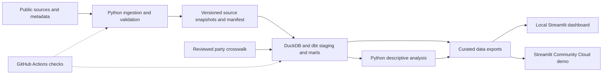

# Architecture and dashboard plan

## Decisions

Development, ingestion, modelling and analysis run locally using Python, DuckDB and dbt Core. Curated, precomputed files now feed a local Streamlit and Plotly dashboard. The intended public demo is Streamlit Community Cloud, subject to a separate source-terms and deployment review; no AWS, Azure, managed database or always-on data pipeline is required. GitHub Actions runs syntax and unit checks on pull requests and `main`; fixture-based data-build checks and optional refresh monitoring remain future work.



Eurostat outcome facts, OECD policy facts, dated cabinet periods and reviewed CHES party-wave positions now feed the local analytics layer. The implemented DuckDB warehouse materializes separate country-year and cabinet-period marts, validates their intended grains, and exports local Parquet snapshots. The local Streamlit dashboard reads those curated exports, preserving flags, keeping cabinet periods separate from annual outcomes and displaying CHES `lrgen` only at its original survey wave. Source terms determine which raw files can be stored or redistributed; raw CHES, ParlGov and OECD snapshots remain excluded from Git. A refresh is a reproducible rebuild followed by validation and a deliberate publication.

## Dashboard wireframe

```text
FairWork | Country explorer | Compare | Methods & sources
-----------------------------------------------------------
Country [Germany v]   Indicator [Pay gap v]   Years [2010—2022]
Unadjusted gender pay gap (%)   [definition and source]
  [trend chart; missing years visible; cabinet markers]
  Select a marker: cabinet dates, parties, source, mapping status
  Party positions: original CHES wave and scale, where matched
Coverage and flags | Download displayed data | Chart export
-----------------------------------------------------------
Interpretation: descriptive; timing does not establish causation.
```

The comparison view uses the same metric and definition across available countries. A policy panel appears only after coverage and comparability checks; otherwise it explains the limitation. The methods view lists definitions, source versions, join rules, missingness and reproducibility instructions. On narrow screens, filters and context stack above and below charts.
