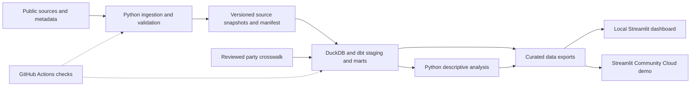

# Architecture and dashboard plan

## Decisions

Development, ingestion, modelling and analysis run locally using Python, DuckDB and dbt Core. Published, precomputed files feed a Streamlit and Plotly dashboard. The intended public demo is Streamlit Community Cloud; no AWS, Azure, managed database or always-on data pipeline is required. GitHub Actions is planned for checks and optional refresh monitoring, subject to repository setup and available quotas.



Eurostat outcome facts, dated cabinet periods and a reviewed party-crosswalk queue now feed the planned analytics layer. Source terms determine which raw files can be stored or redistributed; raw CHES, ParlGov and OECD snapshots remain excluded from Git. Published exports will be read-only snapshots, not a live database. A refresh is a reproducible rebuild followed by validation and a deliberate publication.

## Dashboard wireframe

```text
FairWork | Country explorer | Compare | Methods & sources
-----------------------------------------------------------
Country [Germany v]   Indicator [Pay gap v]   Years [2010—2022]
Unadjusted gender pay gap (%)   [definition and source]
  [trend chart; missing years visible; cabinet markers]
  Select a marker: cabinet dates, parties, source, mapping status
  Party positions: original CHES wave and scale, where matched
Coverage and flags | Download displayed data | Chart export
-----------------------------------------------------------
Interpretation: descriptive; timing does not establish causation.
```

The comparison view uses the same metric and definition across available countries. A policy panel appears only after coverage and comparability checks; otherwise it explains the limitation. The methods view lists definitions, source versions, join rules, missingness and reproducibility instructions. On narrow screens, filters and context stack above and below charts.
