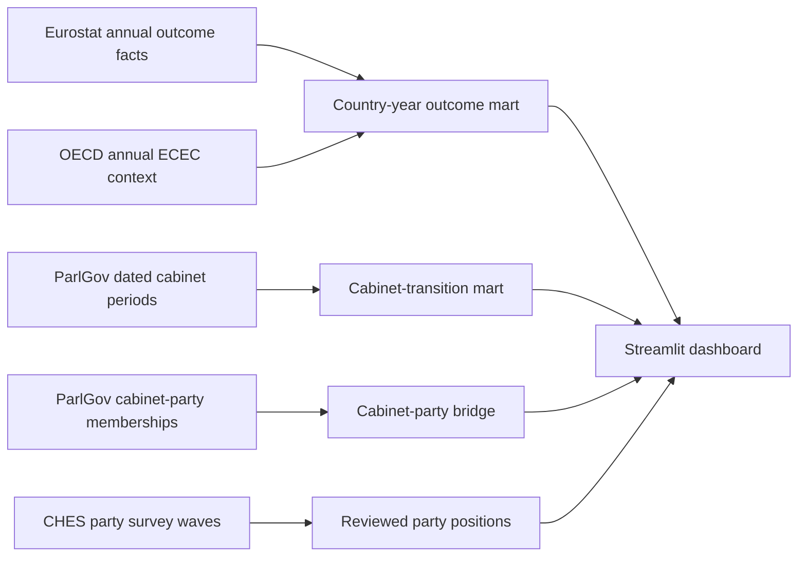
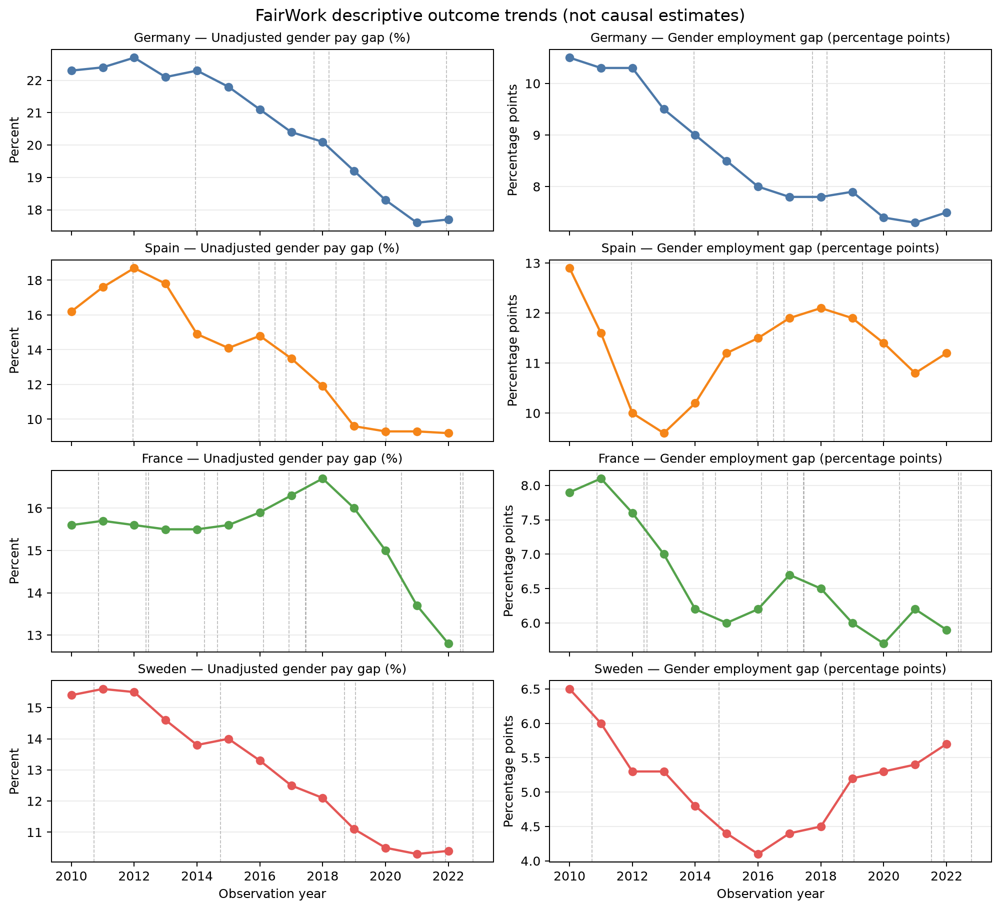
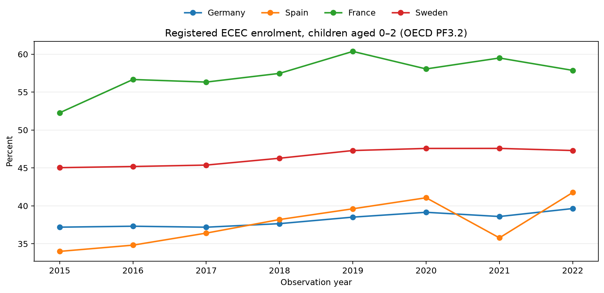
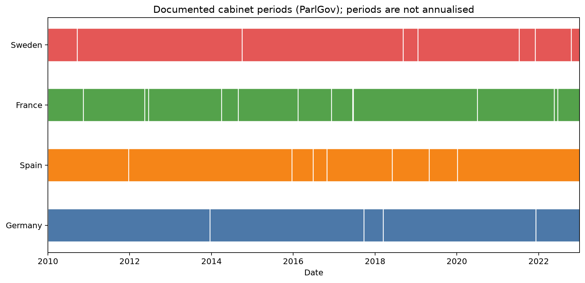
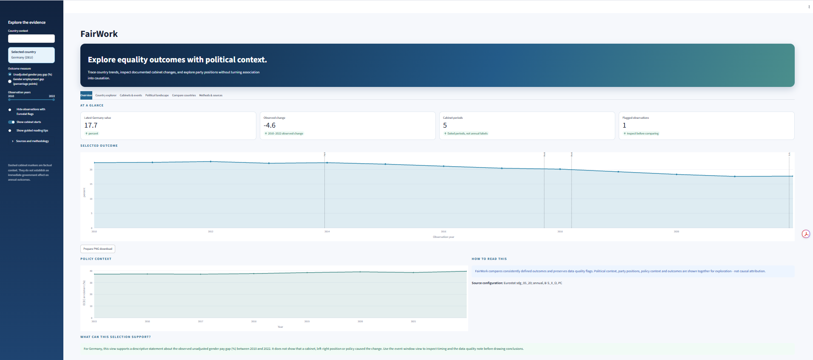
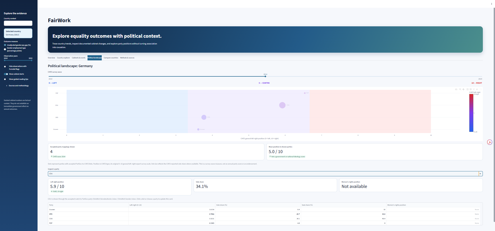
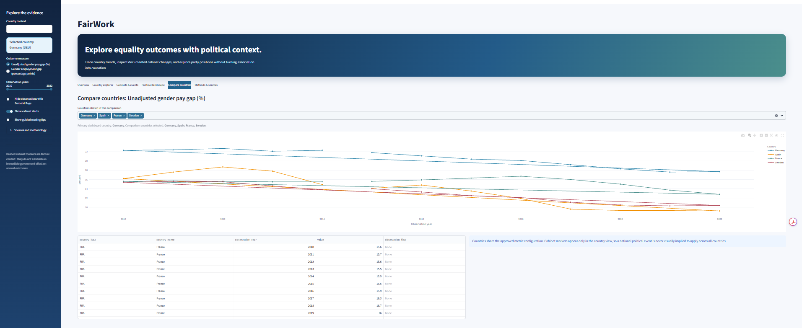
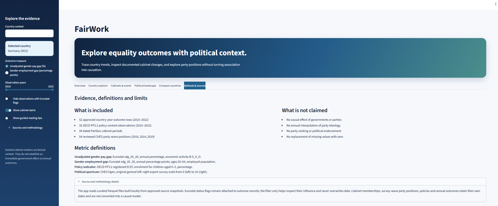
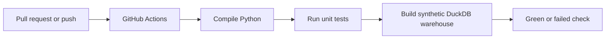
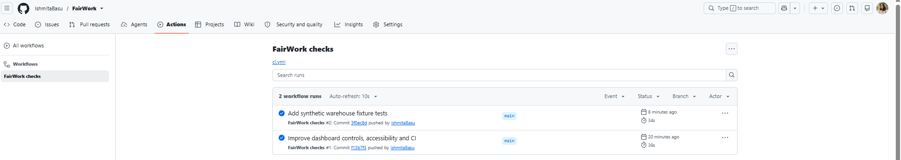

# FairWork: political context and women's economic outcomes in Europe

**Project type:** Reproducible exploratory data product  
**Status:** Local dashboard and automated checks complete; public release remains subject to source-term review  
**Geography and time:** Germany, Spain, France and Sweden; 2010-2022 (OECD policy context: 2015-2022)

## Executive summary

FairWork was created to answer a difficult public-interest question responsibly: when gender pay and employment gaps change, how can we examine political context without pretending that a party label or cabinet date proves causation?

The result is a local interactive data product that combines annual Eurostat outcomes, OECD early-childhood-education-and-care (ECEC) context, dated ParlGov cabinet periods and CHES party-position survey waves. It gives a reader tools to explore patterns, inspect the evidence behind those patterns and see the limits of what the data can support.

The descriptive evidence shows that the unadjusted gender pay gap fell from 2010 to 2022 in all four pilot countries. The gender employment gap also declined in all four, although the size and path of change varied. These are important observed movements, not estimates of a government, ideology or policy effect. The project is deliberately designed to preserve that distinction.

## 1. Why FairWork was built

Debates about left- and right-wing governments often treat a political label as a simple explanation for a complex social outcome. That shortcut has several problems:

- European governments are often coalitions rather than a single party.
- A cabinet can change during an observation year, while gender-outcome data are annual.
- Party positions, enacted policy and observed outcomes are different things measured on different dates.
- Labour-market outcomes also reflect economic conditions, institutions, demographics, measurement choices and long time lags.

FairWork therefore does not answer "which political side is best for women?" Instead, it helps a reader ask better descriptive questions: What changed? When did documented governments change? Which parties are recorded in a cabinet? What did expert surveys measure for those parties in their original survey years? Where are the data flags and gaps?

## 2. Research objective and boundaries

### Objective

Build a transparent exploratory dashboard that places women's economic outcomes beside political and policy context for four European countries, while retaining the source, date, definition, unit and quality flag for the displayed evidence.

### Questions the project can support

1. How did the two approved gender-outcome measures move within each pilot country from 2010 to 2022?
2. Which cabinet periods and party memberships were documented alongside those annual observations?
3. What did CHES measure for accepted party links in 2010, 2014 and 2019?
4. How did the available OECD ECEC context indicator vary across the pilot countries from 2015 to 2022?
5. How sensitive is a simple first-to-last description to Eurostat status flags?

### Questions it cannot answer

- Whether a cabinet, a party's left-right position or an ECEC value caused a gender outcome to change.
- Whether one party or ideology is better than another.
- What an individual party believed in years without a CHES survey observation.
- What would have happened under a different government or policy.

These exclusions are not disclaimers added at the end; they determine the data model, dashboard interactions and wording throughout the project.

## 3. Scope decisions

The pilot contains Germany, Spain, France and Sweden. Outcomes and political context end in 2022, providing a common, documented historical window. The OECD PF3.2 policy-context series begins in 2015. EIGE was excluded because its 2025 methodology reset should not be treated as a directly comparable historical bridge.

| Evidence asset | Scope | Why it is included |
|---|---|---|
| Eurostat `sdg_05_20` | Annual unadjusted gender pay gap, percent | A consistently defined outcome that makes cross-country descriptive comparison possible. |
| Eurostat `sdg_05_30` | Annual gender employment gap, percentage points, ages 20-64 | A second outcome with a distinct labour-market meaning. |
| ParlGov | Dated cabinet periods and memberships | Establishes documented political timing and coalition composition without annualising governments. |
| CHES Europe trend file | Party `lrgen` at 2010, 2014 and 2019 waves | Provides original expert-survey party positions, but only at observed waves. |
| OECD PF3.2 | Registered ECEC enrolment for children aged 0-2, percent | Supplies limited policy context rather than a treatment variable. |

## 4. Data architecture: why the model is deliberately separated

The central analytical choice was to retain different evidence at its natural grain rather than force everything into one annual political score.



This separation prevents two common errors:

1. **Row multiplication.** Joining every cabinet or party to a country-year outcome would duplicate annual observations.
2. **Invented timing.** Assigning a cabinet or party ideology to an entire year hides mid-year transitions and turns intermittent CHES surveys into annual measurements.

The warehouse therefore contains a 52-row country-year outcome mart and a distinct 34-row dated cabinet-transition mart. The dashboard displays cabinet starts as factual markers and uses separate controls for cabinet membership and CHES survey wave.

## 5. Evidence preparation and quality controls

The final pilot contains:

| Item | Count | Treatment |
|---|---:|---|
| Gender-outcome facts | 104 | Two metrics x four countries x thirteen annual observations; Eurostat flags retained. |
| Country-year outcome rows | 52 | One row per country and year; no cabinet joined into the grain. |
| OECD policy-context facts | 32 | Eight years x four countries. |
| Dated cabinet periods | 34 | Half-open periods, not annual labels. |
| Reviewed CHES party-wave positions | 54 | Original 2010, 2014 and 2019 values only. |
| Cabinet-party membership records | 83 | Separate bridge evidence for documented coalition composition. |

Party linkage was handled conservatively. Nineteen links were accepted after identifier and review checks; seven unsupported links were quarantined instead of being guessed from a party name. The dashboard shows accepted positions and keeps unmatched or review-needed context visible where relevant.

The project also preserves Eurostat observation-status flags. A reader can keep all retained observations or use the dashboard's flag filter to inspect how excluding flagged values changes a simple visual comparison. That filter is an inspection tool, not a correction and not an instruction to discard data.

## 6. Descriptive findings

### 6.1 Outcome trends



*Figure 1. Annual outcome trends for the approved pilot. Dashed vertical lines mark documented cabinet starts. The chart shows timing context only and is not a causal estimate.*

For the unadjusted gender pay gap, every pilot country had a lower 2022 value than its 2010 value:

| Country | 2010 | 2022 | Observed first-to-last change |
|---|---:|---:|---:|
| Germany | 22.3% | 17.7% | -4.6 percentage points |
| Spain | 16.2% | 9.2% | -7.0 percentage points |
| France | 15.6% | 12.8% | -2.8 percentage points |
| Sweden | 15.4% | 10.4% | -5.0 percentage points |

The same broad direction appears in the gender employment gap, but the paths differ by country:

| Country | 2010 | 2022 | Observed first-to-last change |
|---|---:|---:|---:|
| Germany | 10.5 pp | 7.5 pp | -3.0 pp |
| Spain | 12.9 pp | 11.2 pp | -1.7 pp |
| France | 7.9 pp | 5.9 pp | -2.0 pp |
| Sweden | 6.5 pp | 5.7 pp | -0.8 pp |

These tables describe endpoints, not a smooth or uniform improvement. Spain's employment-gap series, for example, changes direction during the period. France and Sweden also have non-linear paths. The key conclusion is therefore modest: the selected annual measures improved on this endpoint comparison in all four countries, while the timing and scale of movement differed. No conclusion about political cause follows from that observation.

### 6.2 Policy context



*Figure 2. OECD policy-context series, 2015-2022. This is comparative context, not a measured intervention or a causal explanation of outcomes.*

The ECEC series differs markedly across the pilot countries and changes over time. It is useful context because childcare availability and use may be relevant to labour-market participation. It does not identify a policy change, a policy implementation date, eligibility, affordability, quality, parental leave rules or the conditions needed for causal evaluation. FairWork therefore shows it alongside outcomes rather than merging it into a claim about any particular cabinet.

### 6.3 Political timing and party evidence



*Figure 3. Dated ParlGov cabinet periods. Different counts and transition frequency make a simple country-level political label inappropriate.*

The pilot records five cabinet periods for Germany, eight for Spain, thirteen for France and eight for Sweden. This alone shows why a country cannot be represented by one stable political label across 2010-2022. The dashboard lets the reader select a specific cabinet, see its recorded parties and then select a nearby CHES survey wave. It explicitly does not calculate a coalition ideology score or interpolate party positions across years.

## 7. Flag-sensitivity check

The following is a transparency check, not a causal robustness test. It compares the simple endpoint change with and without observations carrying a retained Eurostat status flag.

| Country and outcome | Flagged observations | Full-window change | Unflagged-window change | Difference |
|---|---:|---:|---:|---:|
| Germany pay gap | 1 | -4.6 | -4.7 | -0.1 |
| Spain pay gap | 0 | -7.0 | -7.0 | 0.0 |
| France pay gap | 0 | -2.8 | -2.8 | 0.0 |
| Sweden pay gap | 0 | -5.0 | -5.0 | 0.0 |
| Germany employment gap | 3 | -3.0 | -2.8 | +0.2 |
| Spain employment gap | 2 | -1.7 | -1.5 | +0.2 |
| France employment gap | 2 | -2.0 | -2.2 | -0.2 |
| Sweden employment gap | 0 | -0.8 | -0.8 | 0.0 |

The small differences here do not make flagged observations unimportant. They demonstrate why flags should remain visible: changing the observation window changes the descriptive comparison, and a reader should be able to inspect that choice instead of having it hidden in preprocessing.

## 8. Dashboard design: how a reader should use it

1. Start on **Overview** and select a country, outcome and year range. Read the metric unit before comparing values.
2. Use **Country explorer** to inspect annual values, flags, cabinet periods and the displayed-data download.
3. Use **Cabinets & events** for timing only. A before/after window shows available observations around a cabinet start; it does not estimate an effect.
4. Use **Political landscape** to inspect accepted CHES party positions at one original survey wave. The blue-to-red spectrum means 0 to 10 on CHES `lrgen`, not good to bad.
5. Use **Compare countries** only with the same metric and year configuration. The selected comparison countries are shown in text so the scope is explicit.
6. Finish on **Methods & sources** to check definitions, coverage and the non-causal boundary.

The dashboard has an explicit selected-country label, visible keyboard focus, source/methodology drawers, non-colour text labels for the spectrum and clear messages for empty filtered views. These details matter because interpretation errors are often interface errors as much as statistical ones.

### 8.1 Dashboard evidence gallery



*Figure 4. Overview of Germany's selected pay-gap series, dated cabinet markers, ECEC context, flags and an explicit descriptive-only interpretation statement.*

.png)

*Figure 5. A selected cabinet displays its recorded parties, a clearly labelled CHES-wave composition count and the separate party-position spectrum. The displayed position span is explicitly not a coalition ideology score.*



*Figure 6. The interactive political landscape preserves the original CHES wave and 0-10 left-right scale. It does not rank parties or make a national ideology claim.*



*Figure 7. Country comparison states every selected country and uses the same outcome definition across the four series.*



*Figure 8. The methods page makes included evidence, excluded claims, metric definitions and source-methodology details visible within the product.*

## 9. Engineering and reproducibility

The project uses Python transforms, DuckDB, local Parquet exports, Streamlit and Plotly. The dashboard reads curated local Parquet files rather than raw source snapshots. GitHub Actions runs syntax checks, unit tests and a DuckDB warehouse build using entirely invented Testland records.



The synthetic fixture verifies that the warehouse can build a country-year mart, preserve a left join for policy context and classify a first cabinet period versus a later cabinet change. It does not copy, publish or test against the restricted local source snapshots.



*Figure 9. GitHub Actions evidence that the automated syntax, unit and synthetic warehouse checks completed successfully on `main`.*

## 10. Limitations and honest conclusions

The project has four major limitations:

1. **No causal design.** Four countries and annual observational data cannot identify government or ideology effects without a separately justified research design, treatment definition, comparison strategy and diagnostics.
2. **Timing mismatch.** Annual outcomes, dated cabinets, policy context and intermittent survey waves have different time structures. FairWork preserves that mismatch rather than hiding it.
3. **Measurement boundaries.** The pay gap is unadjusted; the employment gap has a defined population; ECEC enrolment is not a complete family-policy system; and CHES is an expert survey rather than observed government action.
4. **Publication gate.** The current dashboard is local. Public hosting, dashboard screenshots and downloadable curated data require a fresh licence/redistribution review and a reproducible hosted-data plan.

The responsible conclusion is not that left- or right-wing politics caused the observed trends. It is that FairWork provides a transparent, reproducible way to inspect how outcome movement, documented governing periods, party evidence and limited policy context coexist in the selected historical record. It makes the uncertainty visible and identifies what stronger future research would need.

## 11. Next research steps

- Obtain and document a permitted strategy for updating and hosting source-backed data.
- Add selected macroeconomic and demographic context only after definitions, timing and coverage are documented.
- If a causal question is pursued, preregister a defensible identification strategy and report its assumptions, sample, uncertainty and pre-trend checks separately from the descriptive dashboard.
- Continue review of unmatched party links rather than replacing them with name-based guesses.

## 12. Reproduce locally

With approved local source snapshots available, run:

```powershell
python -m pip install -e ".[audit,pipeline,analysis,dashboard]"
python -m src.transforms.build_outcome_panel
python -m src.transforms.build_policy_context
python -m src.transforms.build_political_context
python -m src.transforms.build_party_positions
python -m src.analytics.build_warehouse
python -m src.analytics.export_curated_data
python -m unittest discover -s tests -v
python -m streamlit run app.py
```

For project setup, dashboard navigation and the release gate, see the README, `docs/dashboard_guide.md` and `docs/deployment_readiness.md`.
