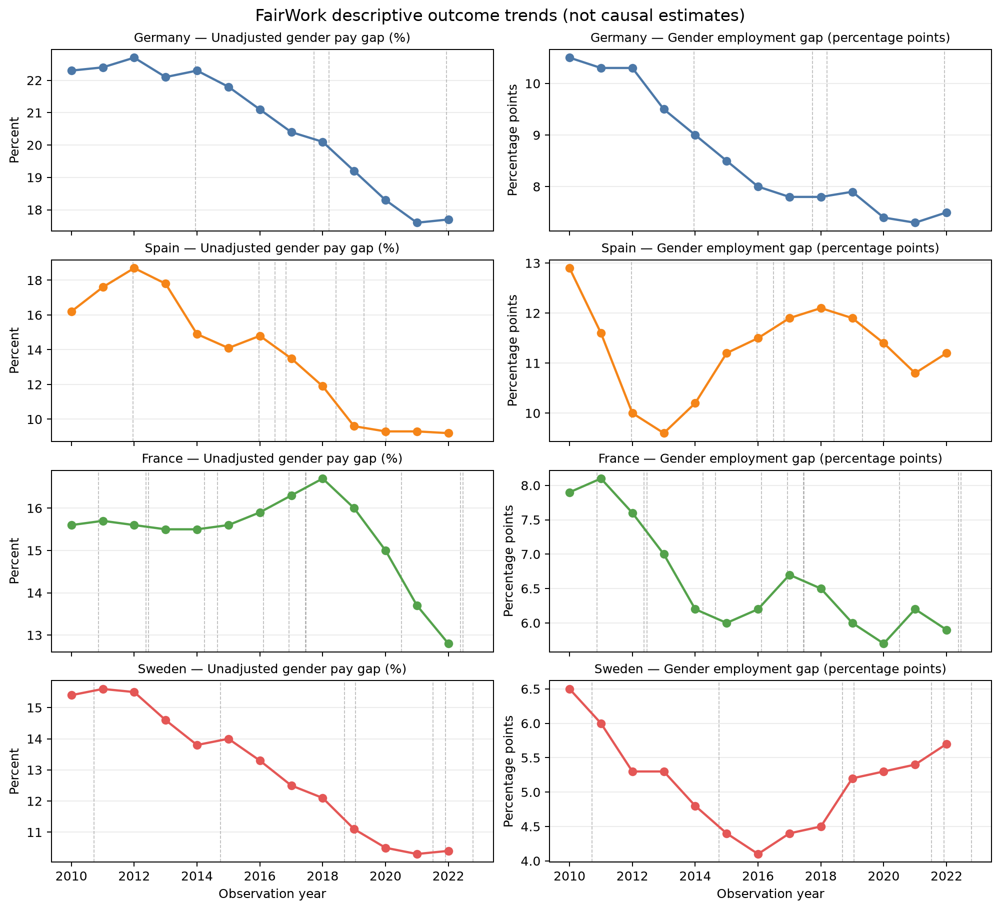
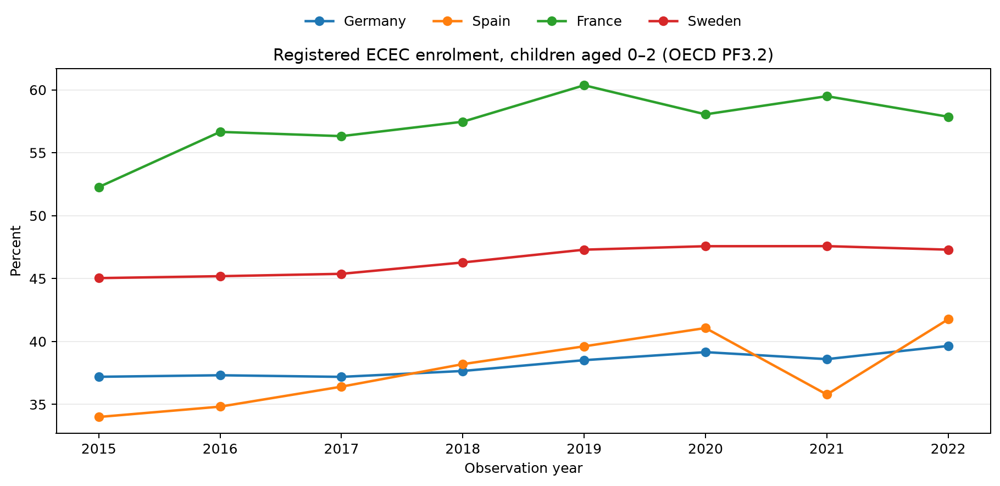
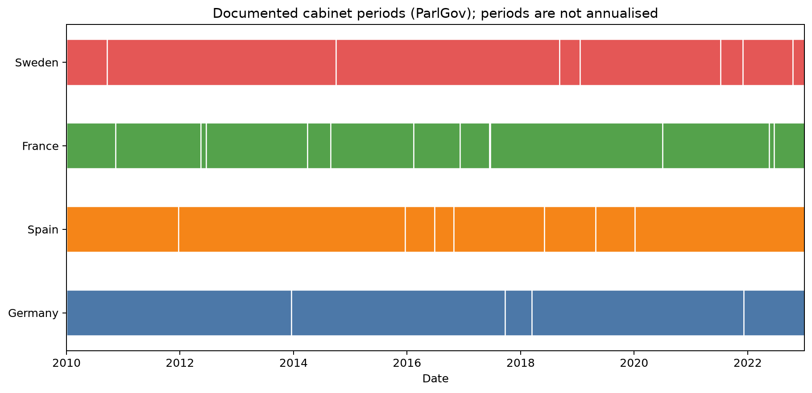

# Phase 5 descriptive results

**Status:** Descriptive baseline complete; no causal analysis has been performed.  
**Scope:** Germany, Spain, France and Sweden; outcomes 2010–2022; OECD policy context 2015–2022.

## Coverage and data quality

| asset | expected rows | observed rows | coverage window |
| --- | --- | --- | --- |
| Gender outcome facts | 104 | 104 | 2010-2022 |
| Country-year mart | 52 | 52 | 2010-2022 |
| OECD policy facts | 32 | 32 | 2015-2022 |
| Cabinet periods | 34 | 34 | 2010-2022 |

Eurostat status flags remain attached to the outcome facts. The accompanying `outcome_flag_summary.csv` lists their distribution; they are not silently removed or recoded.

## First-to-last descriptive changes

The figures below compare the first and last available observation within each country. They describe observed movement only; they are not estimates of a government or policy effect.

| country name | metric | first year | first value | last year | last value | net change | flagged observations |
| --- | --- | --- | --- | --- | --- | --- | --- |
| Germany | Unadjusted gender pay gap (%) | 2010 | 22.30 | 2022 | 17.70 | -4.60 | 1 |
| Spain | Unadjusted gender pay gap (%) | 2010 | 16.20 | 2022 | 9.20 | -7.00 | 0 |
| France | Unadjusted gender pay gap (%) | 2010 | 15.60 | 2022 | 12.80 | -2.80 | 0 |
| Sweden | Unadjusted gender pay gap (%) | 2010 | 15.40 | 2022 | 10.40 | -5.00 | 0 |
| Germany | Gender employment gap (percentage points) | 2010 | 10.50 | 2022 | 7.50 | -3.00 | 3 |
| Spain | Gender employment gap (percentage points) | 2010 | 12.90 | 2022 | 11.20 | -1.70 | 2 |
| France | Gender employment gap (percentage points) | 2010 | 7.90 | 2022 | 5.90 | -2.00 | 2 |
| Sweden | Gender employment gap (percentage points) | 2010 | 6.50 | 2022 | 5.70 | -0.80 | 0 |



Dashed lines show pilot-country cabinet starts. They are visual context only: one annual outcome must not be attributed to a cabinet solely because its date overlaps a calendar year.





## Flag sensitivity and cabinet coverage

The sensitivity table compares the full first-to-last window to a view excluding observations carrying a Eurostat status flag. A changed window can change the comparison even when the underlying series is valid, so this is a transparency check rather than a correction.

| country name | metric | flagged observations | full window change | unflagged window change | change difference |
| --- | --- | --- | --- | --- | --- |
| Germany | Unadjusted gender pay gap (%) | 1 | -4.60 | -4.70 | -0.10 |
| Spain | Unadjusted gender pay gap (%) | 0 | -7.00 | -7.00 | 0.00 |
| France | Unadjusted gender pay gap (%) | 0 | -2.80 | -2.80 | 0.00 |
| Sweden | Unadjusted gender pay gap (%) | 0 | -5.00 | -5.00 | 0.00 |
| Germany | Gender employment gap (percentage points) | 3 | -3.00 | -2.80 | 0.20 |
| Spain | Gender employment gap (percentage points) | 2 | -1.70 | -1.50 | 0.20 |
| France | Gender employment gap (percentage points) | 2 | -2.00 | -2.20 | -0.20 |
| Sweden | Gender employment gap (percentage points) | 0 | -0.80 | -0.80 | 0.00 |

| country name | cabinet periods | cabinet changes after first |
| --- | --- | --- |
| Germany | 5 | 4 |
| Spain | 8 | 7 |
| France | 13 | 12 |
| Sweden | 8 | 7 |

## Interpretation limits

- This four-country panel is too small and too confounded to support causal conclusions from these descriptive comparisons.
- CHES party positions remain survey-wave measures and are not used here as annual government ideology values.
- The OECD ECEC indicator is policy context, not evidence that a named government enacted or caused a policy outcome.
- Future analysis must report the Eurostat flags, missingness and the political crosswalk review queue alongside any charts or model outputs.

## Reproduction

```powershell
python -m src.analytics.build_warehouse
python -m src.analysis.run_descriptive_analysis
```
